<div align="center">

# robust-freecad-mcp

**Production-grade FreeCAD automation: precision-verified by measurement, token-efficient via Code Mode.**

An MCP server where AI agents build FreeCAD parts in **⚡ Code Mode**, which makes it ***efficient***. One short
JavaScript program drives a typed `cad` API, so a whole build → validate → repair loop is a single call at
**~15× fewer tokens**. The results are **🛡️ robust**: ***measured and tested***. Every dimension, hole and gram is
**measured** from the exported STEP in a separate sandboxed process, and the parametric model is **stress-tested**
with flex tests. Untrusted CAD code runs in a **kernel sandbox**, and the agent **sees** a render of what it built.


<table>
<tr>
<td>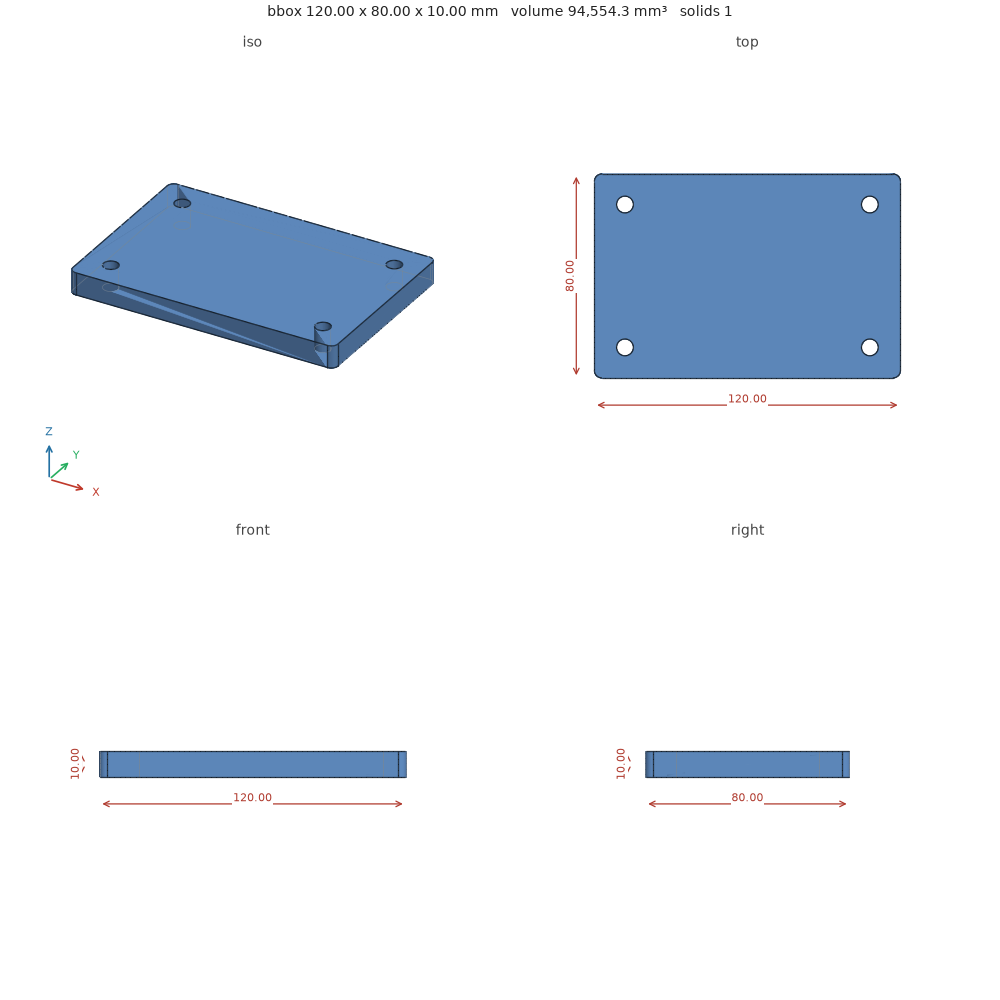</td>
<td>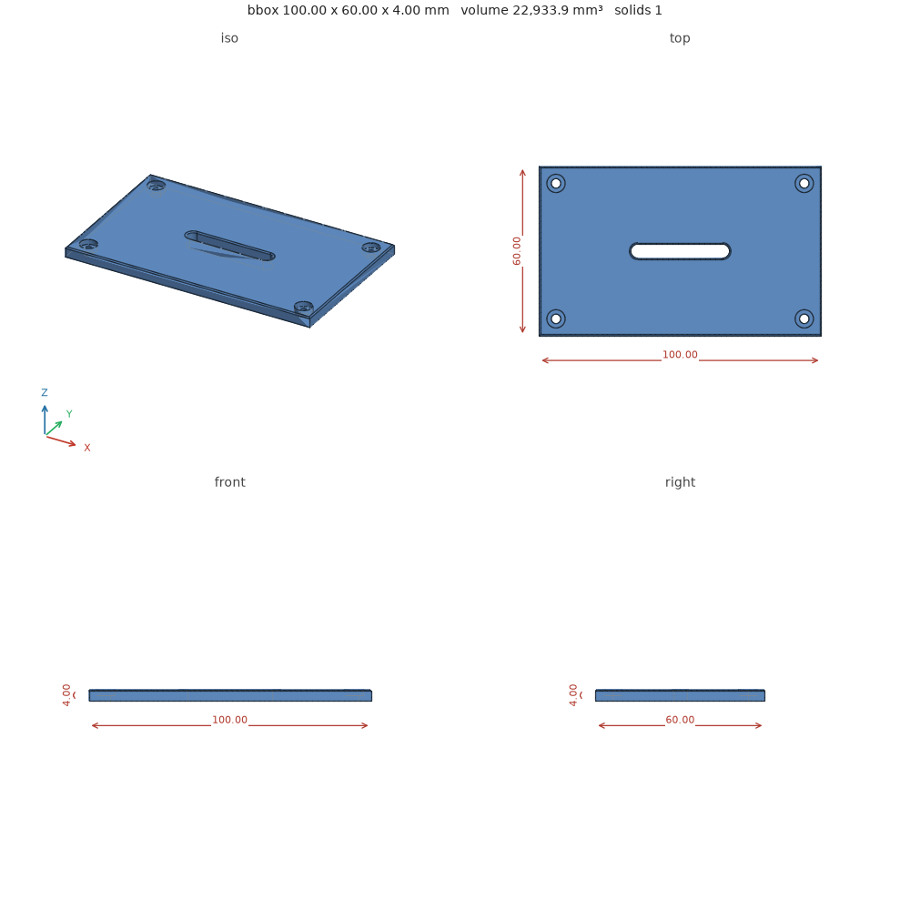</td>
<td>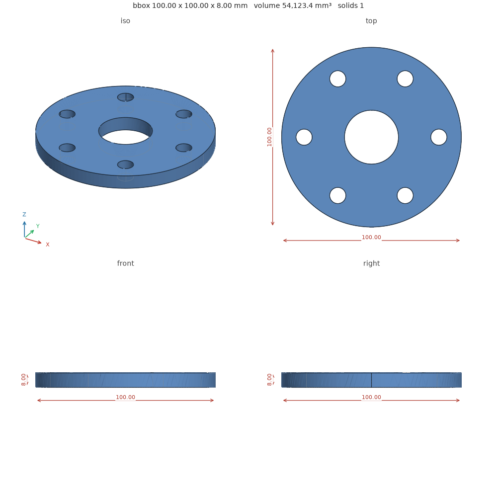</td>
</tr>
<tr>
<td align="center"><sub>Mounting plate · 6/6 checks · 255 g Al</sub></td>
<td align="center"><sub>Enclosure lid · 6/6 checks · 62 g Al</sub></td>
<td align="center"><sub>Bolt-circle flange · 6/6 checks · 146 g Al</sub></td>
</tr>
</table>
<sub>These are the actual PNG previews the server returns to the agent. All three were built in parallel by a single <code>execute</code> call.</sub>

</div>

---

## Why it's different

| | Typical FreeCAD MCP server | **robust-freecad-mcp** |
|---|---|---|
| **How the agent works** | 7–60 tools, one round-trip per operation | **4 tools.** The agent writes a short JS program that drives a typed `cad` API: loops, parallel variants and repairs in **one call** |
| **Did it work?** | "The script ran" | **Measured**: validity, solids, bounding box, volume, every hole's position, diameter and depth, mass, sketch degrees of freedom |
| **Is it really parametric?** | Untested | **Flex tests** reopen the saved model, change parameters, rebuild and re-check |
| **Can the agent see it?** | Screenshot of a live GUI, if any | **Headless 4-view render** with dimensions, returned as an image the model can look at |
| **Untrusted Python** | Runs with your user's full privileges | **Kernel sandbox**: Landlock (filesystem + TCP), seccomp (no sockets/exec/fork), rlimits |
| **Who measures** | The same process that ran the script | A **separate process that never runs job code** re-imports the exported STEP/FCStd |
| **Context cost** | Full scripts and results every time | Scripts stay on the server; results are **compact** by default (~15× fewer tokens, measured below) |

The full write-up is in [docs/why.md](docs/why.md), and the landscape survey in [docs/landscape-and-tool-design.md](docs/landscape-and-tool-design.md).

<picture>
  <source media="(prefers-color-scheme: dark)" srcset="docs/images/feature-matrix-dark.svg">
  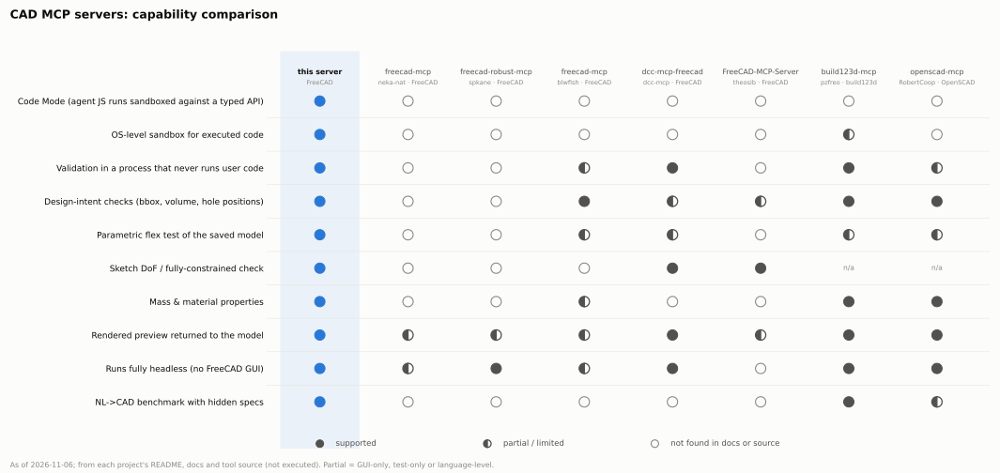
</picture>

## How a request flows

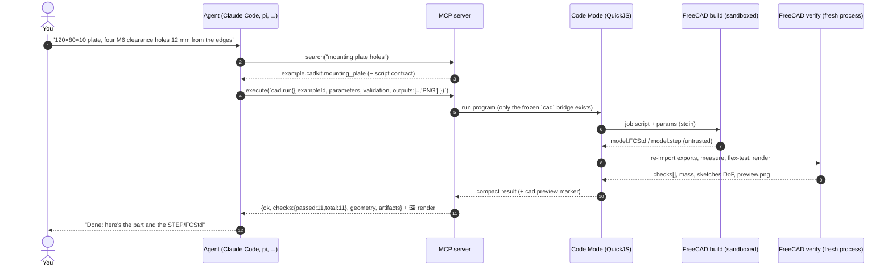

If a check fails, the agent gets `failed: [{name, expected, actual, message}]` and repairs it in
**one more call** without resending the script:
`cad.run({ fromJob: id, parameters: { edge: 15 } })` or `cad.run({ fromJob: id, patch: [{ find, replace }] })`.

## Highlights

### 🧠 Code Mode first: one call, whole workflow

```js
// Build three variants in parallel, validate each, rank them, and look at the winner.
const variants = await Promise.all(["aluminum_6061", "steel", "pla"].map(material =>
  cad.run({ exampleId: "example.cadkit.mounting_plate", outputs: ["FCStd", "STEP", "PNG"],
            validation: { material, maxMassG: 400, expectedBoundingBoxMm: [120, 80, 10] } })));
const best = variants.filter(v => v.ok).sort((a, b) => a.massG - b.massG)[0];
return { table: variants.map(v => [v.id, v.ok, v.massG]), best: best.id, look: await cad.preview(best.id) };
```

`cad.run · submit · wait · result · compare · preview · search · example · status · cancel · artifacts · logs · version`.
The whole API ships as a TypeScript declaration in the `execute` tool description, so clients can cache it.

### 💸 Token-lean by design

Measured on the mounting plate, using the `execute` program as input and its result as output (≈4 chars/token):

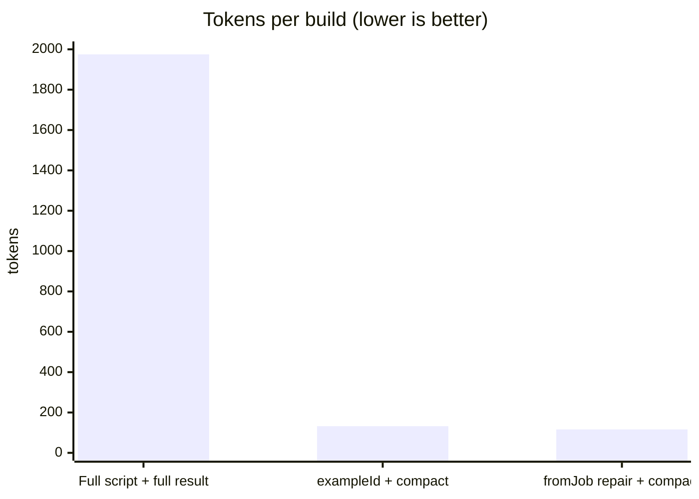

| Call style | in | out | total |
|---|---:|---:|---:|
| Send full PartDesign script, receive full result | 1,100 | 875 | **1,975** |
| `cad.run({ exampleId, validation })`, compact result | 54 | 78 | **132** |
| `cad.run({ fromJob, parameters })` (repair/variant) | 38 | 78 | **116** |

How it's lean:
- Scripts never round-trip through the model: start from a catalog example (`exampleId`) or an earlier job (`fromJob` + exact-text `patch`).
- Passing checks are only counted, while failing ones are listed in full with expected vs actual.
- `cadkit` helpers turn an ~80-line PartDesign script into ~10 lines.
- Every `execute` response reports its own `responseChars` and `approxTokens`.

### 📐 Validation that measures, not trusts

```json
{ "id": "job_…", "ok": false, "checks": { "passed": 9, "total": 10 },
  "failed": [{ "name": "boundingBox", "expected": [150, 80, 10], "actual": [140, 80, 10],
               "message": "Bounding box [140.0, 80.0, 10.0] differs from expected [150, 80, 10] (tolerance 0.01 mm)." }] }
```

| Check family | What is verified |
|---|---|
| Shape | not null, `isValid()`, ≥1 solid, exact solid count |
| Size | bounding box (±tol), volume (±%), axis-swap hint |
| Holes | each expected hole: centre (from bbox corner or origin), diameter, through-depth; concave full cylinders only |
| Mass | 12 materials (Al 6061, steel, 304, brass, Cu, Ti, ABS, PLA, PETG, nylon, PC, acetal); `maxMassG` |
| Parametric | feature tree has constraints/expressions; **every sketch fully constrained** (DoF = 0) |
| **Flex tests** | reopen the FCStd → set spreadsheet params (e.g. `length: 150`) → recompute → still valid, still solid, expected bbox/volume/holes |
| Artifacts | STEP re-imports, FCStd re-opens and matches STEP volume, STL watertight, PNG not blank |

Artifacts are published **only when every check passes**.

### 👀 The agent sees what it built

Add `"PNG"` to `outputs` and return `cad.preview(id)`. The server attaches the 4-view render (iso, top,
front and right at one shared scale, with hidden-line edges and dimension callouts) as MCP **image content**.
The bytes come from the artifact store, and the marker is checked against the caller's own jobs.

### 🔒 Two sandboxes, one trust boundary each

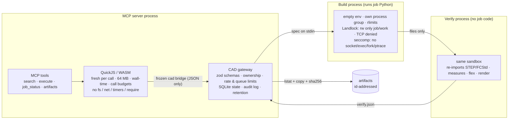

Escape attempts are covered by tests (`tests/cad`, `tests/sandbox`). Jobs can't read `~` or `/etc/passwd`,
other processes' `/proc/*/environ`, open TCP/UDP/unix sockets, run `subprocess`, `fork`, create symlinks,
or signal the server. In the JS sandbox, `require`, `fetch`, `process`, timers and the host globals are all
absent, and busy loops, memory bombs and never-settling promises are cut off.

### 🤖 Embedded pi agent: `design` = plain English in, verified part out

Enable with `FREECAD_MCP_DESIGN=1` and the server gains a fifth tool. It runs a **[pi](https://www.npmjs.com/package/@earendil-works/pi-coding-agent)
agent in-process** with no shell, file or MCP tools, only the `cad` API. The agent is split into three roles so
that it never grades its own homework:

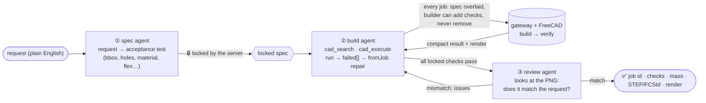

- **Budgets:** Code Mode iterations (default 4), USD (default $1, summed from provider usage) and wall time. Model credentials stay in the server process.
- **Async:** `design {request}` returns a `dsn_…` id, and `design {designId, waitMs}` polls it. On success the final render is attached as an image.
- **Also usable without MCP:** `node dist/apps/design-agent/src/cli.js "a 60×40×30 open tray, 2.5 mm walls" --budget 0.5` (bin: `freecad-design`).
- **Any pi-supported model, or your own GPU:** `FREECAD_MCP_DESIGN_MODEL=provider/id`, or a self-hosted endpoint with `FREECAD_MCP_DESIGN_BASE_URL=http://localhost:8000/v1 FREECAD_MCP_DESIGN_MODEL=Qwen3.8-27B`. A local Qwen3.8-27B built the mounting plate first time (15/15 checks, render approved).
- **Tests:** four end-to-end tests drive real FreeCAD with pi's deterministic *faux* model. They show that a builder trying to weaken
  the spec still fails, that a `fromJob` repair passes, that the reviewer receives the image, that review feedback loops back,
  and that the iteration budget holds.

### 🧩 Discovery that fits in context

`search` returns 3–5 ranked catalog hits (33 entries covering contract, examples, Part/Sketcher/PartDesign API,
`cadkit` and pitfalls). Vetted `cadkit` examples rank first. For precise filtering, `search` also takes **code**:

```js
return catalog.entries.filter(e => e.kind === "pitfall").map(e => [e.id, e.summary]);
```

## Quick start

```bash
git clone https://github.com/YunchaoYang/robust-freecad-mcp.git && cd robust-freecad-mcp
./scripts/setup-env.sh                      # micromamba env: FreeCAD 1.1.3 + Node 22, npm ci, build (no root)

claude mcp add robust-freecad \
  -e FREECAD_MCP_PYTHON=$HOME/micromamba/envs/freecad-mcp/bin/python \
  -- $HOME/micromamba/envs/freecad-mcp/bin/node $PWD/dist/apps/mcp-server/src/server.js
```

Then ask your agent: *"Design a 120 × 80 × 10 mm aluminium plate with four M6 clearance holes 12 mm from the
edges. Make it parametric, validate it and show me a render."*

<details>
<summary><b>pi</b>, the <b>MCP Inspector</b> and other clients</summary>

```bash
pi mcp add robust-freecad --env FREECAD_MCP_PYTHON=$HOME/micromamba/envs/freecad-mcp/bin/python \
  -- $HOME/micromamba/envs/freecad-mcp/bin/node $PWD/dist/apps/mcp-server/src/server.js
```

In `~/.pi/agent/mcp.json`, set `"exposure": "direct"` (our `execute` already *is* Code Mode, so pi's own codemode
wrapper only adds a hop) and `"timeout": 600`. See [`integrations/pi/mcp.json`](integrations/pi/mcp.json). Copy
[`integrations/pi/skills/freecad-design`](integrations/pi/skills/freecad-design/SKILL.md) into your pi skills for the
spec-first design loop.

```bash
npm run inspector                           # MCP Inspector UI
```

Any client that speaks MCP over stdio works. Copy [`.mcp.json.example`](.mcp.json.example) to `.mcp.json` (fill in your paths) for a project-scoped Claude Code config.
</details>

## Reference

<details>
<summary><b>Tools</b></summary>

| Tool | Purpose |
|---|---|
| `search` | Ranked catalog hits, `{id}` for one entry with example source, or `{code}` for read-only JS over the catalog. Always includes the script contract. |
| `execute` | Runs a Code Mode program (async function body or `async () => {…}`) with the `cad` bridge. Returns `{ok, result \| error, logs, stats}` plus attached preview images. |
| `job_status` | State, geometry, checks, artifacts and an error with `hint`. Options: `waitMs`, `includeEvents`, `includeLogs`, `cancel`. |
| `artifacts` | List artifacts, or fetch one by id: metadata, `freecad-artifact://` resource URI, local `file://` URI, optional inline content (PNG as an image). |
| `design` *(opt-in)* | Embedded pi agent: plain-English request → locked acceptance spec → validated build → visual review. Async (`dsn_…` id). |

</details>

<details>
<summary><b>Job script contract</b></summary>

FreeCAD Python runs headless. `App`, `Part`, `Sketcher`, `params` and `cadkit` are pre-bound. The script must set
`doc` (the document) and `result_obj` (the final object with `.Shape`, e.g. a PartDesign Body). See
[`packages/cad-api/contract.md`](packages/cad-api/contract.md) and the
[examples](packages/cad-api/examples/). With `cadkit`:

```python
m = cadkit.Model("MountingPlate", length=120, width=80, thickness=10, hole=cadkit.clearance("M6"), edge=12, corner=3)
outline = m.sketch("Outline"); outline.rounded_rect(0, 0, "length", "width", "corner")
m.pad(outline, "thickness", name="Plate")
holes = m.sketch("Holes")
for i, (x, y) in enumerate([("edge", "edge"), ("length - edge", "edge"), ("edge", "width - edge"), ("length - edge", "width - edge")]):
    holes.circle(x, y, "hole", label=f"Hole{i}")
m.pocket(holes)
doc, result_obj = m.finish()
```

</details>

<details>
<summary><b>Configuration (environment variables)</b></summary>

| Variable | Default | |
|---|---|---|
| `FREECAD_MCP_PYTHON` | `python3` | Python of the FreeCAD env (FreeCAD lib = `<prefix>/lib`, override with `FREECAD_MCP_FREECAD_LIB`) |
| `FREECAD_MCP_DATA_DIR` | `./data` | SQLite DB, audit log, job dirs |
| `FREECAD_MCP_PRINCIPAL` | `local` | Owner identity for jobs |
| `FREECAD_MCP_MAX_CONCURRENT` / `_MAX_QUEUED` / `_MAX_ACTIVE_PER_USER` / `_SUBMISSIONS_PER_MIN` | 2 / 32 / 8 / 30 | Queue and rate limits |
| `FREECAD_MCP_JOB_TIMEOUT_SEC` / `_MAX_JOB_TIMEOUT_SEC` | 120 / 600 | Wall time per worker phase (also the CPU rlimit) |
| `FREECAD_MCP_ADDRESS_SPACE_MB` / `_FILE_SIZE_MB` | 4096 / 256 | Worker rlimits |
| `FREECAD_MCP_RETENTION_HOURS` | 72 | Finished jobs and files are deleted after this |
| `FREECAD_MCP_KEEP_WORKDIRS` | 0 | Keep sandbox work dirs for debugging |
| `FREECAD_MCP_ALLOW_UNSANDBOXED` | 0 | Run jobs without Landlock/seccomp (never with untrusted input) |
| `FREECAD_MCP_DESIGN` | 0 | `1` registers the `design` tool (embedded pi agent) |
| `FREECAD_MCP_DESIGN_MODEL` | first logged-in pi model | `provider/id`, or the model id when using a base URL |
| `FREECAD_MCP_DESIGN_BASE_URL` | – | Self-hosted OpenAI-compatible endpoint (vLLM, SGLang, llama.cpp), e.g. `http://localhost:8000/v1` |
| `FREECAD_MCP_DESIGN_THINKING` / `_VISION` / `_API_KEY` / `_CONTEXT` | `low` / `1` / `none` / from server | Local-model tuning |

</details>

<details>
<summary><b>Repository layout</b></summary>

```text
apps/mcp-server/     MCP tools, stdio transport, preview → image content
apps/code-runtime/   QuickJS sandbox, cad bridge (run/fromJob/patch/compact/compare), budgets
apps/cad-gateway/    job queue, SQLite store, worker launcher, catalog, audit, retention
apps/cad-worker/     FreeCAD build/verify phases, Landlock+seccomp sandbox, validator, renderer, cadkit
apps/design-agent/   embedded pi agent (spec → locked build → visual review), manager, freecad-design CLI
packages/shared/     zod schemas (CadJobRequest, validation), structured errors
packages/cad-api/    catalog.json, contract.md, runnable examples
integrations/pi/     pi mcp.json (direct exposure) and the freecad-design skill
tests/               sandbox · mcp · e2e (Node), cad (Python), eval (NL→CAD benchmark)
infra/               Dockerfile + compose (untested starting point)
```

</details>

## Benchmarks

<picture>
  <source media="(prefers-color-scheme: dark)" srcset="docs/images/eval-dark.svg">
  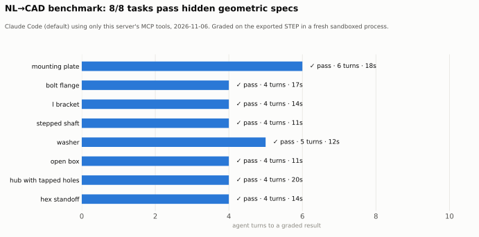
</picture>

**8/8 plain-English → CAD tasks pass hidden specs:** mounting plate, bolt flange, L-bracket, stepped shaft, washer, open tray,
hub with tapped holes, hex standoff. The median run took 4 turns and 11–20 s per task, and the whole suite cost $1.26.
- **Setup:** Claude Code's default model with only this server's 4 tools, one run per task, on 2026-11-06.
- **Grading:** each task's exported STEP is graded in a fresh sandboxed process. The grader checks an orientation-free bbox, volume within 0.5 %, hole diameters and counts,
  and plate edge offsets, and it passes the reference solutions for all 8 tasks.
- *Caveat: a small, single-part, single-run suite.* Reproduce with `python3 tests/eval/run_eval.py`.

**Local model, server-side agent:** the same 8 tasks and grader with the embedded pi `design` agent on a **local
Qwen3.8-27B (vLLM)** gave **5/8 passes and 0 false positives**: every part the agent called done also passed the hidden spec.
The 3 failures hit the 15-min limit. Two came from an `import App` shadowing bug that is now fixed. Data:
[`docs/data/eval_design_qwen.json`](docs/data/eval_design_qwen.json).

<picture>
  <source media="(prefers-color-scheme: dark)" srcset="docs/images/eval-design-dark.svg">
  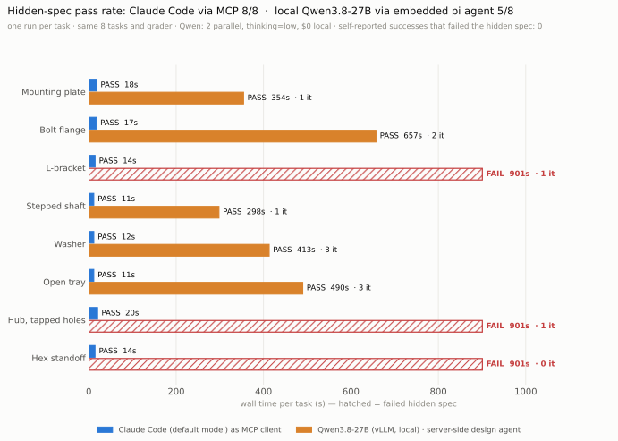
</picture>

<picture>
  <source media="(prefers-color-scheme: dark)" srcset="docs/images/tool-tokens-dark.svg">
  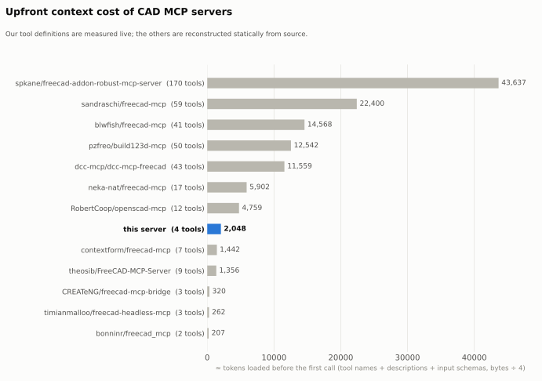
</picture>

<sub>Upfront tool-definition cost: ours was measured live via `tools/list`. Other servers were reconstructed statically from source, never executed.
Tokens ≈ bytes / 4. Data: [`docs/data/`](docs/data/).</sub>

## Tests

```bash
npm test                                      # 35 tests: JS sandbox & budgets, MCP protocol, e2e on real FreeCAD, embedded pi agent
python3 -m unittest discover -s tests/cad     # 29 tests: worker, plate gate, editability, renders, escapes
```

The end-to-end suite drives the built server over stdio. It builds, validates, renders and flex-tests parts,
repairs a wrong dimension via `fromJob`, sweeps materials in parallel, and checks that the PNG arrives as an image.
It then re-imports the STEP and edits the FCStd in a separate FreeCAD process. An agent run (`claude -p` with
only this server) built the plate from plain English in 5 turns and about 34 s.

## Status and limits

| Area | State |
|---|---|
| Execution engine, MCP + gateway, Code Mode, discovery, agent integration | ✅ done and tested |
| Previews, mass, fully-constrained sketches, flex tests, token-lean bridge | ✅ done and tested |
| Embedded pi `design` agent | ✅ tested with pi's scripted faux model · ✅ real run with a **local Qwen3.8-27B (vLLM)**: mounting plate 15/15 checks, visual review passed, 2 iterations, ~6.6 min (1 run) |
| Isolation | ✅ Landlock + seccomp + rlimits, cancel, quotas, retention, audit, restart recovery · ⚠️ container/microVM recipe in `infra/` is **untested** |
| Multi-user | ⚠️ single principal over stdio; no HTTP transport or real auth yet |

Pinned: FreeCAD 1.1.3 (conda-forge) · Node 22.23 · `@modelcontextprotocol/sdk` 1.32.2 · `quickjs-emscripten` 0.32.0 · `zod` 4.6.7.
Tested on Ubuntu 24.04 aarch64, kernel 6.14.
