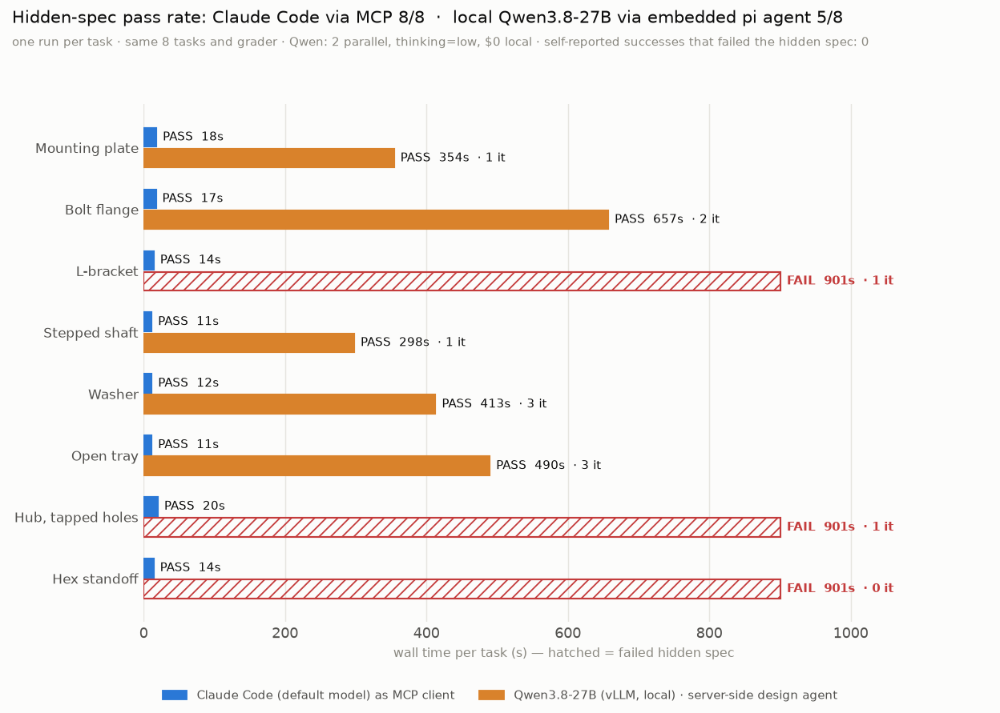
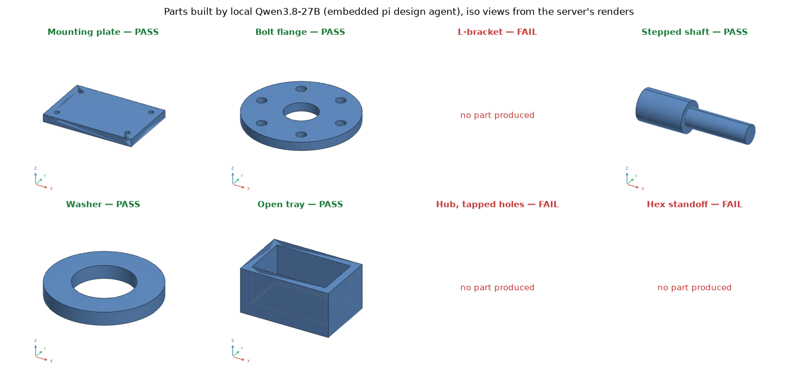

# robust-freecad-mcp：最终报告

日期：2026-11-06（2026-11-10 补充本地模型运行） · 仓库：https://github.com/YunchaoYang/robust-freecad-mcp
依据：`FreeCAD_Code_Mode_MCP_Build_Plan.md`（v1.0）

---

## 1. 结论

计划的 6 个阶段中，**5 个已完成并有测试**。第 5 阶段（隔离与可靠性）**部分完成**：内核级沙箱已实现，容器/microVM 方案未在本机验证。

在计划之外，还新增了以下能力：
- **嵌入式 pi 智能体**：`design` 工具，输入自然语言，输出经过验证的零件。
- **渲染预览**：模型能"看到"自己建的零件。
- **质量、柔性与约束检查**：质量/材料、柔性测试（flex test）、草图全约束检查。
- **Token 节省接口**：`exampleId` / `fromJob` / 紧凑结果。

| 指标 | 结果 |
|---|---|
| Node 测试（沙箱、MCP 协议、真实 FreeCAD 端到端、嵌入式 pi 智能体） | **34 / 34 通过** |
| Python 测试（worker、计划第 1 阶段验收、可编辑性、渲染、逃逸） | **28 / 28 通过** |
| 自然语言→CAD 评测（8 个任务，隐藏规格判分） | **8 / 8 通过**；中位 4 轮，单任务 11–20 s，全套 $1.26 |
| 计划第 1 阶段验收零件（120×80×10 安装板，4×M6 通孔） | 检查全部通过，FCStd 可再编辑，STEP 可被独立导入 |
| 计划第 6 阶段验收（`claude -p` 仅用本服务器） | 5 轮、约 34 s、$0.26，14/14 检查一次通过 |
| Token：完整脚本 + 完整结果 vs `exampleId` + 紧凑结果 | **≈1,975 vs ≈132**（约 15 倍） |
| 工具定义首付成本（`tools/list`，4 个工具） | 8,514 字节 ≈ 2,128 tokens |
| **嵌入式 pi 智能体 + 本地 Qwen3.8-27B（vLLM，localhost:8000）** | 单次试跑：安装板 15/15 检查通过，视觉复核通过 |
| **本地 Qwen 8 任务评测（同一隐藏规格判分）** | **5 / 8 通过，误报 0**；3 个失败都是 15 分钟超时，其中 2 个由已修复的 `import App` 问题引起；中位耗时 573 s，$0 |

> 评测说明：样本小，只有单零件、单次运行。评测由协作会话（freecad-97）完成，方法见第 6 节。

---

## 2. 系统架构

```text
MCP 客户端（Claude Code / pi / Inspector）
        │ stdio
        ▼
MCP 服务器（TypeScript）: search | execute | job_status | artifacts | design（可选）
        │
        ├─ Code Mode 运行时：QuickJS(WASM)，每次调用全新实例，只注入冻结的 `cad` 接口
        │
        ├─ 嵌入式 pi 智能体（design）：规格 → 锁定 → 构建 → 视觉复核
        │
        ▼
CAD 网关：zod 校验、所有权、速率/队列限制、SQLite 状态、审计日志、保留期清理
        │ 作业规格经 stdin 传入
        ▼
FreeCAD worker，构建阶段（运行不可信 Python）：Landlock + seccomp + rlimits
FreeCAD worker，验证阶段（新进程，不运行作业代码）：重新导入 STEP/FCStd，测量、柔性测试、渲染
        │
        ▼
产物：复制出沙箱、计算 sha256、只按服务器签发的 ID 访问
```

**分工：**
- **本会话（TypeScript 侧）**：MCP 服务器、Code Mode 运行时、网关、共享 schema、嵌入式 pi 智能体、README，以及 Node 测试。
- **协作会话 freecad-97**：FreeCAD worker（`cadkit`、渲染器、验证器）、目录（33 条）、Python 测试、评测与 `docs/why.md`、对比图。

两个会话通过跨会话消息约定了接口契约。

---

## 3. 对照计划的完成情况

| 阶段 | 计划验收标准 | 状态 | 证据 |
|---|---|---|---|
| 1 FreeCAD 执行引擎 | 安装板能在 FreeCAD 中打开、能被独立 STEP 导入器读取，几何断言通过 | ✅ | `tests/cad`；e2e 用独立 FreeCAD 进程导入 STEP，并把 FCStd 参数 `length` 改为 150 后重建 |
| 2 MCP 与网关 | 客户端不接触 FreeCAD 也能提交作业并取回已验证产物 | ✅ | `tests/mcp`；MCP Inspector CLI 能列出并调用工具 |
| 3 Code Mode | 一次 `execute` 即可提交并检查作业 | ✅ | `tests/sandbox`（11 项隔离/预算测试）；e2e |
| 4 API 发现 | 不加载整个目录就能找到相关示例 | ✅ | 搜索 "mounting plate four holes" 时示例排第一；另支持 search-as-code |
| 5 隔离与可靠性 | 越权访问失败，资源耗尽被控制住 | ⚠️ 部分完成 | Landlock/seccomp/rlimits 的逃逸测试已覆盖；取消、配额、保留期、审计、重启恢复、幂等键已实现。**容器/microVM 方案未验证** |
| 6 智能体集成 | 智能体端到端生成、验证、修复、导出 | ✅ | `claude -p` 实测；8/8 评测；pi 已连通 |

**主机限制**：本机无 sudo，Docker 不可用，AppArmor 禁止非特权 user namespace。因此 bwrap 和容器都不能用，改为不需要 root 的 **Landlock（ABI 6）+ seccomp**。测试确认以下操作全部被拦截：
- 读取 `~`、`/etc/passwd`、其他进程的 `/proc/*/environ`
- 在作业目录外写文件、创建符号链接
- 创建 TCP、UDP 或 Unix socket
- 调用 subprocess、fork，向其他进程发信号

---

## 4. 主要能力

1. **Code Mode 优先**：一次 `execute` 就能完成搜索、构建、验证、修复、并行变体和比较。`cad` 接口以 TypeScript 声明的形式写在工具描述中，内容固定，便于客户端缓存。
2. **验证靠测量，不靠信任**：
   - 形状有效、实体数、包围盒、体积
   - 每个孔的位置、直径、是否贯通
   - 质量（12 种材料）
   - 草图自由度
   - 柔性测试：重开 FCStd，修改参数，重建后再检查
   - 产物可读性

   失败时返回 `failed[{name, expected, actual, message}]`。
3. **"谁运行，谁不测量"**：验证在一个**不运行作业代码**的独立进程中完成，基于导出文件重新测量。
4. **模型能看到零件**：四视图 PNG（iso/top/front/right，同一比例，含尺寸标注）以 MCP 图像内容返回；伪造的预览标记无效。
5. **节省 Token**：
   - `cad.run({exampleId})`：从目录示例出发，脚本不经过模型
   - `cad.run({fromJob, patch|parameters})`：修复时不重发脚本
   - 结果默认紧凑：通过的检查只计数
   - `cadkit` 把约 80 行的 PartDesign 脚本缩短到约 10 行
   - 每次响应都报告 `approxTokens`
6. **嵌入式 pi 智能体（`design` 工具）**：见下一节。

---

## 5. 嵌入 pi 智能体

### 四个接入层级

| 层级 | 内容 | 状态 |
|---|---|---|
| 1. pi 作为 MCP 客户端 | `integrations/pi/mcp.json`，设置 `"exposure": "direct"` 和 `"timeout": 600` | ✅ 已验证：`pi mcp list` 显示 connected，4 个工具，direct。验证在独立的临时 pi 配置目录中进行，未改动用户的 `~/.pi` |
| 2. pi 技能 | `integrations/pi/skills/freecad-design/SKILL.md`：先规格、后构建、看图、有限次修复 | ✅ 已编写（未用真实模型运行） |
| 3. 服务器内嵌智能体 `design` | 见下文 | ✅ 已实现；faux 模型端到端测试通过；**本地 Qwen3.8-27B 真实运行成功** |
| 4. pi RPC 子进程隔离 | 用于多用户部署 | 📝 仅为设计方案 |

### `design` 的工作方式

开关：`FREECAD_MCP_DESIGN=1`；代码在 `apps/design-agent/`。

- **三个相互隔离的 pi SDK 会话**，都没有内置工具（无 bash/read/write/edit），也不加载扩展、技能、上下文文件或 MCP：
  1. **规格智能体**：先把需求转换成验收规格（包围盒、孔、材料、柔性测试等），由**服务器锁定**。
  2. **构建智能体**：只有 `cad_search` 和 `cad_execute`。每个作业都会被叠加锁定规格，构建者**只能加检查，不能删检查**，即"不给自己批改作业"。
  3. **复核智能体**：查看渲染图，判断是否符合需求。不符合时把问题反馈给构建者，最多复核 2 轮。
- **预算**：迭代次数（默认 4）、美元（默认 $1，按服务商报告的用量累计）、墙钟时间（默认 15 分钟）。
- **安全**：模型凭据只留在服务器进程内，不会进入 QuickJS 或 FreeCAD worker。提示注入最多只能消耗预算。
- **用法**：MCP 中 `design {request}` 返回 `dsn_…` ID，用 `design {designId, waitMs}` 轮询，成功时附带最终渲染图。命令行：`node dist/apps/design-agent/src/cli.js "<需求>" --budget 1`。

### 测试（`tests/e2e/design-agent.test.ts`，4 项，用真实 FreeCAD 加 pi 的确定性 faux 模型）

- 构建者试图放宽规格（把包围盒改为 110 并清空孔检查）时，作业**仍按锁定规格失败**。之后用 `fromJob` 修复并通过。构建者和复核者都收到了图像，客户端也收到了最终渲染。
- 迭代预算生效，失败结果为结构化信息（`VALIDATION_FAILED` 及失败的检查项）。
- 视觉复核不符合时（"需要直角"），问题会回传给构建者；第二次复核通过。
- 未知或他人的 ID 返回 `NOT_FOUND`。

### 真实模型运行：本地 Qwen3.8-27B（2026-11-10）

模型由 vLLM 0.32 在 `localhost:8000` 提供（FP8，64k 上下文）。运行前确认了三项能力：文本对话、工具调用、图像输入。图像测试中，模型正确数出法兰渲染图上的 6 个螺栓孔。

接入方式是新增"自托管 OpenAI 兼容端点"支持：
- 设置 `FREECAD_MCP_DESIGN_BASE_URL=http://localhost:8000/v1` 和 `FREECAD_MCP_DESIGN_MODEL=Qwen3.8-27B`
- 使用 pi 的 `openai-completions` API，思考格式为 `qwen-chat-template`
- 使用独立的模型运行时，不读写 `~/.pi`
- 可选环境变量：`FREECAD_MCP_DESIGN_THINKING`（默认 `low`）、`FREECAD_MCP_DESIGN_VISION`、`FREECAD_MCP_DESIGN_API_KEY`、`FREECAD_MCP_DESIGN_CONTEXT`

测试需求："120×80×10 mm 铝安装板，4 个 M6 通孔，孔心距边 12 mm，参数化"。

| 阶段 | 结果 |
|---|---|
| 规格（锁定） | 包围盒 [120,80,10]、体积 94,631.7 mm³（±0.5%，模型自己算出）、4 个 Ø6.6 通孔位于 (12,12)(108,12)(12,68)(108,68)、`requireParametric`、6061 铝 |
| 构建 | 第 2 次 `cad_execute` 提交作业，**一次通过 15/15 检查**；体积 94,631.5 mm³，质量 255.5 g；导出 FCStd、STEP、PNG |
| 视觉复核 | 模型看渲染图后判定 `matches: true` |
| 开销 | 约 2.0 万输入 + 0.48 万输出 tokens，394.6 s，$0（本地推理） |

注意：
- **这只是 1 次运行、1 个零件**，不能说明成功率。
- 第 1 次 `cad_execute` 没有提交作业（模型先做了探查或脚本出错），事件日志没有记录细节。
- 主要耗时在本地推理。

### 尚未验证的部分（如实说明）

- **云端模型未运行**。本机 pi 未登录。检查 API key 的操作被自动模式分类器以"凭据探查"为由拒绝，因此改用本地模型完成真实运行。
- faux 模型和本地模型的费用都为 0，所以**美元预算的中止路径没有在实际运行中触发过**（逻辑已实现）。
- 设计记录只保存在内存中，服务器重启后丢失。作业本身持久化在 SQLite 中，不受影响。

---

## 6. 评测方法

由 freecad-97 完成，数据在 `docs/data/eval_results.json`。

- **任务（8 个）**：安装板、螺栓法兰、L 形支架、阶梯轴、垫圈、开口托盘、带螺纹孔的轮毂、六角支柱。
- **运行方式**：`claude -p`，使用 Claude Code 默认模型，只允许本服务器的 4 个工具，每个任务运行一次。
- **判分方式**：在全新的沙箱验证进程中检查导出的 STEP，比较与方向无关的包围盒、体积（误差 0.5% 以内）、孔径和孔数，安装板还检查孔到边距离。判分器对 8 个参考解全部判为通过。
- **局限**：任务少，都是单零件，每个只运行一次，模型单一。还不能证明在更复杂零件（装配、曲面、公差链）上同样有效。

---

### 本地 Qwen3.8-27B 跑 8 个评测任务（`design` 智能体，2026-11-10）



设置：任务和隐藏规格判分与 Claude Code 那轮完全相同；智能体换成服务器内嵌的 pi 流程（写规格 → 锁定 → 建模 → 看图复核）。具体参数：Qwen3.8-27B（vLLM 0.32，FP8），思考强度 `low`，每个任务最多 4 次迭代、限时 15 分钟，2 个任务并行，每个任务跑 1 次。数据在 `docs/data/eval_design_qwen.json`，复现命令为 `python3 tests/eval/run_design_eval.py`。

| 任务 | 智能体自报 | 隐藏规格 | 迭代 | 耗时 | 锁定检查 | 输入 / 输出 tokens |
|---|---|---|---|---|---|---|
| 安装板 | 成功 | ✅ | 1 | 354 s | 14/14 | 13.7k / 5.9k |
| 螺栓法兰 | 成功 | ✅ | 2 | 657 s | 17/17 | 41.1k / 10.6k |
| L 形支架 | 超时取消 | ❌ 无零件 | 1 | 901 s | — | 28.1k / 12.6k |
| 阶梯轴 | 成功 | ✅ | 1 | 298 s | 9/9 | 15.3k / 4.7k |
| 垫圈 | 成功 | ✅ | 3 | 413 s | 11/11 | 75.1k / 5.9k |
| 开口托盘 | 成功 | ✅ | 3 | 490 s | 9/9 | 38.1k / 7.6k |
| 带螺纹孔的轮毂 | 超时取消 | ❌ 无零件 | 1 | 901 s | — | 17.9k / 12.1k |
| 六角支柱 | 超时取消 | ❌ 无零件 | 0 | 901 s | — | 0.6k / 5.7k |



结论：
- **5/8 通过，误报 0。** 智能体自报成功的 5 个，全部通过了独立的隐藏规格判分。"锁定规格 + 独立测量"这套机制在本地模型上同样可信：它没有把失败的零件说成成功。
- **两个失败是我们服务器的问题，已修复。** L 形支架和轮毂的脚本都写了 `import App`。FreeCAD 环境里恰好有另一个同名模块，覆盖了预先注入的 `App`，导致报错 `module 'App' has no attribute 'newDocument'`。现在执行任务脚本前会把 `App` 指向 FreeCAD，并加了回归测试。
- **超时的直接原因很可能是单次生成过长。** 出错后（或六角支柱一开始），模型很久没有提交新作业，直到 15 分钟上限。当时单次输出上限是 16k tokens，本地生成速度下最长要十几分钟。现在本地模型的上限降到 8k，可通过 `FREECAD_MCP_DESIGN_MAX_TOKENS` 调整。
- **速度：** Claude Code（云端，MCP 客户端）每个任务 11–20 s，本地 Qwen 每个任务 5–11 分钟。差距主要来自模型和硬件，**不能**用来说明 Code Mode 的作用。Code Mode 的作用见下面的消融实验。

## 7. 风险与局限

| 项目 | 说明 |
|---|---|
| 多用户 | 目前只有单一身份，经 stdio 使用；没有 HTTP 传输，也没有真正的认证 |
| 容器/microVM | `infra/` 下的 Dockerfile 和 compose 文件**未验证** |
| Landlock 读权限 | 作业可以读取 FreeCAD 环境前缀和系统库（其中没有敏感信息，但属于可读面） |
| 磁盘配额 | 只有单文件大小限制，没有作业总量配额 |
| 嵌入式智能体 | 本地 Qwen 8 任务 5/8（每个任务只跑 1 次）；本地生成慢，有超时风险（已把单次输出上限降到 8k）；美元预算中止未实测；设计记录不持久化 |
| 品牌 | 已定名 `robust-freecad-mcp`（MCP 服务器名 `robust-freecad`） |
| 版本控制 | 项目尚未建立 git 仓库 |

---

## 8. 建议的下一步

1. **扩大 `design` 的真实模型测试**：用本地 Qwen 跑完 8 个评测任务，每个运行多次，与 Claude Code 直接调用工具（8/8）对比成功率、轮数和耗时。复现命令：
   `FREECAD_MCP_PYTHON=~/micromamba/envs/freecad-mcp/bin/python FREECAD_MCP_DESIGN_BASE_URL=http://localhost:8000/v1 FREECAD_MCP_DESIGN_MODEL=Qwen3.8-27B node dist/apps/design-agent/src/cli.js "<需求>"`
2. **持久化设计记录**：存入 SQLite，并加入 MCP 进度通知。
3. **多用户**：加入 HTTP 传输和认证；用 pi RPC 子进程隔离模型调用；在有 Docker 或 microVM 的主机上验证 `infra/`。
4. **扩大评测**：更多零件类型，每个任务多次运行，覆盖多个模型。
5. **确定品牌名**，然后建立 git 仓库并做首次提交。

---

## 9. 复现方式

```bash
cd robust-freecad-mcp
export PATH=~/micromamba/envs/freecad-mcp/bin:$PATH
npm test                                         # 34 项 Node 测试
python3 -m unittest discover -s tests/cad        # 28 项 Python 测试
npm run inspector                                # MCP Inspector
python3 tests/eval/run_eval.py                   # 评测（会调用 claude -p，产生费用）
```
