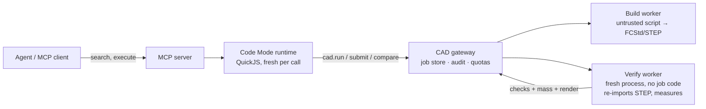
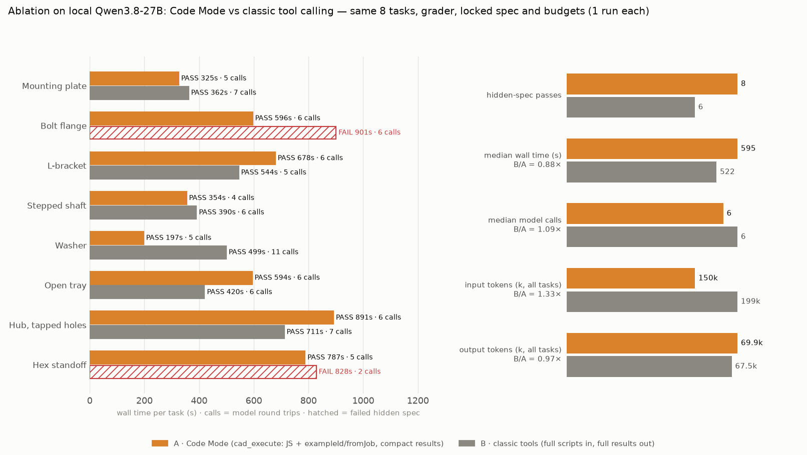

# Don't Trust the Model, Measure the Part: Lessons from Building an Agent-Ready FreeCAD Server

*How we built [robust-freecad-mcp](https://github.com/YunchaoYang/robust-freecad-mcp), what the evals taught us, and a blueprint for doing the same with any CAD/CAE tool.*

---

## TL;DR

- **Verification is the product.** An LLM that says "done" means nothing. A separate process re-imports the exported STEP and measures it. That is what earns trust: across 24 local-model runs we saw **zero false positives**.
- **Lock the spec before you build.** A separate stage turns the request into numeric acceptance criteria. The builder cannot edit them, so it cannot move the goalposts.
- **Code Mode beats tool sprawl, but for different reasons than you'd guess.** In a controlled ablation it gave **8/8 vs 6/8** passes and used **25–40 % fewer input tokens**. On a local GPU it gave *no* wall-time win.
- **Two sandboxes, one per trust boundary.** One holds the model's orchestration code and one holds the CAD kernel's Python, each with its own limits.
- **Evals find server bugs, not just model bugs.** Our first local-model eval surfaced a real worker bug (`import App` shadowing), and fixing it moved the pass rate.
- **Most of the architecture is tool-agnostic.** Only a thin "backend adapter" knows about FreeCAD. That is the part you swap for CadQuery, Gmsh, CalculiX or OpenFOAM.

---

## 1. The problem: LLMs are confident, geometry is not

Ask any capable model for "a 120×80×10 mm plate with four M6 clearance holes 12 mm from the edges" and it will happily write FreeCAD Python. Sometimes that Python is right. Sometimes the holes are 6 mm instead of 6.4 mm. Sometimes they are 12 mm from the *wrong* edge, or the boolean silently fails and you export an empty shape. The model reports success every time.

So the hard part of "LLM + CAD" isn't generation. It is **knowing whether the part is correct**, cheaply, every time, without a human opening the file.

Everything else in the design follows from that.

## 2. Architecture at a glance



- **MCP surface:** four small tools (`search`, `execute`, `job_status`, `artifacts`), plus an opt-in `design` tool that runs a full agent on the server.
- **Code Mode runtime:** the model writes a short JS program against a typed `cad.*` API. One tool call can run a whole workflow: submit, wait, compare, patch and resubmit.
- **Gateway:** jobs, idempotency keys, ownership, rate and queue limits, retention, restart recovery and an audit log. It is boring infrastructure, and it is essential.
- **Workers:** a two-phase pipeline in which *build* runs the untrusted script and *verify* runs in a separate fresh process that never sees that script.

## 3. Lesson 1: Verification must be independent of generation

The single most important decision was splitting **build** and **verify** into different processes.

- Build executes model-written Python and exports FCStd and STEP.
- Verify starts clean. It re-imports the **exported STEP** (the artifact the user actually gets) and measures:
  - validity and solid count;
  - bounding box (orientation-free);
  - volume within tolerance;
  - hole diameters, counts and positions;
  - mass from material density;
  - optional flex tests (change a parameter, rebuild, re-measure) and sketch constraint status.

If the model's in-memory shape is fine but the STEP export is broken, verify catches it. If the script monkey-patches something to make checks pass, verify doesn't care, because it never runs that script.

**Result:** across 24 runs of the server-side agent on a local 27B model (3 configurations × 8 tasks), every self-reported success also passed a hidden-spec grader that the agent never saw. Weak models fail *loudly* in this system, not silently.

> Takeaway: put the measuring instrument outside the reach of the thing being measured.

## 4. Lesson 2: Lock the spec, or the agent will negotiate with itself

Our embedded agent runs three separate sessions:

1. **Spec:** turns plain English into a numeric `ValidationSpec` (bbox, volume, holes and so on). This spec is then **locked**.
2. **Build:** iterates against the locked spec. It sees the spec through a `lockedBridge` overlay that injects the checks into every job and ignores any attempt to supply its own.
3. **Visual review:** a separate session looks at the rendered preview and can veto the result.

Before locking, we saw the classic failure mode: after a few failed attempts, the builder "discovers" that the tolerance should be looser. Separating *what counts as correct* from *trying to be correct* removed that whole class of problem.

## 5. Lesson 3: Code Mode helps, but measure where the win actually comes from

The appeal of "Code Mode" (one `execute` tool and a typed API, instead of dozens of tools) is usually pitched as *fewer tool definitions in context*. That is real: our whole tool surface is about 2.1k tokens. But it turned out to be the smaller effect.

The larger effect was **what stops flowing through the context window**:

| Pattern | Approx. tokens per round trip |
|---|---|
| Full script in + full result out | ~1,975 |
| `exampleId` + parameter overrides, compact result | ~132 |
| Repair via `fromJob` + exact-text `patch` | ~116 |

Then we ran a proper ablation on a local Qwen3.8-27B. We held the same tasks, grader, locked spec and budgets, and swapped *only* the build-stage tools:



| | Code Mode | Classic tools | Classic / CM |
|---|---|---|---|
| Hidden-spec passes | **8/8** | 6/8 | — |
| Input tokens, 6 tasks both passed | **108k** | 182k | 1.68× |
| Build-stage model calls (paired) | **19** | 30 | 1.58× |
| Output tokens (all) | 69.9k | 67.5k | 0.97× |
| Median wall time / task | 595 s | 522 s | 0.88× |

The honest reading:

- **Reliability and input tokens improve.** Reusing scripts by reference means long code and long results don't keep re-entering the context, which leaves fewer chances for a smaller model to lose the thread.
- **Wall time doesn't improve on a local GPU.** Output tokens were the same, decoding dominates, and prefill is cheap. On a per-token cloud model the input saving turns straight into cost.
- **One run per task is not significance.** The same Code Mode configuration scored 5/8 in an earlier run on a pre-fix build. Treat 8-vs-6 as directional.

> Takeaway: don't sell Code Mode as "faster." Sell it as "fewer tokens, fewer round trips, more reliable." Then run the ablation that proves it.

## 6. Lesson 4: Two sandboxes, one per trust boundary

There are two kinds of untrusted code here, and they need different jails:

1. **Model-written orchestration JS** runs in QuickJS (WASM), with a fresh runtime per call. It has budgets for time, memory, bridge calls, concurrency, output and log size, and it gets a frozen `cad` object that passes only JSON strings.
2. **Model-written FreeCAD Python** runs in an OS-sandboxed worker process.

Our host blocked unprivileged user namespaces (no Docker, no bubblewrap), so the worker **sandboxes itself** before running any job code:

- rlimits;
- a Landlock filesystem allowlist, plus TCP denial and signal/abstract-socket scoping;
- a seccomp filter that denies `socket`, `execve`, `fork`/non-thread `clone`, `ptrace`, and so on.

Escape tests are part of the Python test suite.

> Takeaway: your sandbox plan must survive the environment you actually deploy to. A kernel-level self-sandbox is a good fallback when containers aren't available.

## 7. Lesson 5: Evals debug the *server*

Our first local-model eval scored 5/8. The tempting conclusion was "small model, expected." The traces said otherwise. Two failures were the script doing `import App`, which in that headless environment resolved to an unrelated module instead of FreeCAD. That was **our bug**. We fixed it by aliasing `sys.modules["App"]` before running the job and added a regression test.

The third failure was a single 15-minute generation. The fix was a budget: cap max tokens per local generation.

Things that made eval failures diagnosable:

- **Tracebacks trimmed to job-script frames**, so the model and the human both see the line that matters.
- **Error codes with hints** (`SCRIPT_CONTRACT`, `RECOMPUTE_ERROR` plus the first failing feature, `EXPORT_FAILED`, …).
- **Per-stage timing and model-call counts** in every design record.
- **A hidden-spec grader** kept separate from the agent's own checks, so "agent was wrong" and "agent lied" are distinguishable.

## 8. Lesson 6: Smaller lessons that cost us hours

- **Let the model see its part.** A rendered PNG preview, returned as MCP image content, catches "technically valid, obviously wrong" geometry that numbers miss.
- **Documentation is an API.** The typed `cad` declaration plus four canonical patterns in the tool description did more for first-try success than any prompt tuning.
- **Defaults merging is a footgun.** `{ visualCheck: undefined }` silently overrode a `true` default. Filter undefined values before merging options.
- **Example parameters vs. script literals.** Merging an example's *default* parameters into the request overrode the literals in a patched script, so patches did nothing. Pass only what the caller overrides.
- **Parallel agents need ownership boundaries.** Two coding sessions editing the same repo overwrote each other until we split directories by owner.

## 9. Generalizing: a blueprint for any CAD/CAE tool

Almost none of the stack is FreeCAD-specific. Here is the split:

| Layer | Generic (reuse as is) | Backend-specific (write per tool) |
|---|---|---|
| MCP surface | search / execute / status / artifacts tools, resources | — |
| Code Mode runtime | QuickJS sandbox, budgets, bridge plumbing | API doc + examples for the `cad.*` / `sim.*` surface |
| Gateway | jobs, idempotency, quotas, audit, retention, recovery | resource classes (CPU, GPU, MPI ranks) |
| Worker | process launch, OS sandbox, log tailing | **build**, **export**, **verify**, **render** |
| Validation | spec schema plumbing, compare, locking | domain checks (geometry, mesh, physics) |
| Agent | spec → locked build → review pipeline | domain prompts |
| Eval | hidden-spec harness, ablation runner, plots | tasks + reference solutions |

### The backend adapter contract

```python
class Backend(Protocol):
    name: str
    def describe(self) -> ApiDoc: ...                     # typed API + canonical examples for search
    def build(self, script: str, params: dict, out: Path) -> BuildResult: ...   # untrusted, sandboxed
    def verify(self, artifacts: list[Path], spec: Spec) -> list[Check]: ...      # fresh process, no job code
    def render(self, artifact: Path) -> bytes: ...        # PNG for the agent's eyes
    sandbox_policy: SandboxPolicy                          # fs allowlist, syscalls, rlimits
```

### What changes for CAD backends (CadQuery, build123d, OpenSCAD, Onshape/SolidWorks APIs)

- **Neutral exchange format is the key to independent verification.** If the backend can export STEP, the existing OCC-based verifier works unchanged. Verify the *artifact*, not the kernel's in-memory object.
- **Use a separate measuring library if you can.** Building with CadQuery and verifying with FreeCAD (or the reverse) catches kernel-specific export bugs.
- **Cloud CAD APIs** (Onshape and similar) replace the OS sandbox with API-scope sandboxing: per-job documents, scoped tokens, and no access to the user's other documents.

### What changes for CAE backends (Gmsh, CalculiX, Code_Aster, OpenFOAM, FEniCS, Elmer)

- **The validation spec grows from geometry to physics.**
  - *Mesh:* element count bounds, min scaled Jacobian, max aspect ratio, no inverted elements.
  - *Solve:* converged residuals, no NaNs, iteration counts within budget.
  - *Physics sanity:* mass and energy balance; reactions equal applied loads.
  - *Answer checks:* max displacement or stress within tolerance of an **analytic benchmark** (cantilever beam, pressurized cylinder, Poiseuille flow), so hidden-spec grading works like it does for geometry.
  - *Robustness:* a mesh-refinement check that the quantity of interest changes by less than X %. This is the CAE analogue of our "flex test."
- **Verify by reading results with a different reader.** For example, the solver writes VTK or FRD, and the verifier reads it with meshio or pyvista in a fresh process and recomputes the quantities.
- **Jobs get long.** Async submit/wait/cancel, progress logs and idempotency stop being nice-to-haves. The worker launcher may become a Slurm/HPC submitter, and the gateway's quotas become core-hours.
- **Sandbox policy must be per backend.** Solvers legitimately need `fork`/`exec` (MPI, mesher → solver pipelines) and sometimes shared memory. Allow them per backend, keep network denied, and keep the filesystem scoped to the job directory.
- **Compact results matter even more.** Never stream a result field into the context. Return summaries (max, min, location, residual history tail) and let the agent ask for more by reference, the way `fromJob` works.

### A minimal order of work for a new backend

1. Write `verify()` first, with 3–5 reference parts or cases it must pass.
2. Write `build()` and `export()` with the sandbox from day one.
3. Add `describe()` docs with 3–4 canonical examples that are reusable via `exampleId`.
4. Write an 8-task hidden-spec eval before any prompt tuning.
5. Run the ablation (Code Mode vs classic) on *your* backend. Don't assume our numbers transfer.

## 10. Closing

The pattern that made this work is old engineering hygiene applied to a new kind of operator:

- write the requirement down before the work starts;
- measure the delivered artifact with an independent instrument;
- keep untrusted hands in a box sized to the job;
- benchmark claims before you make them.

LLMs make CAD and CAE automation *accessible*. Verification makes it *usable*.

---

*Code, data and figures: [github.com/YunchaoYang/robust-freecad-mcp](https://github.com/YunchaoYang/robust-freecad-mcp). Full eval write-up: [issue #1](https://github.com/YunchaoYang/robust-freecad-mcp/issues/1).*
