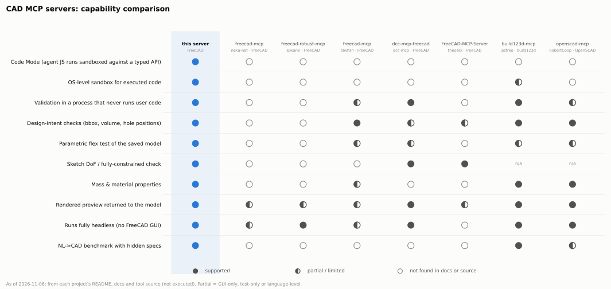
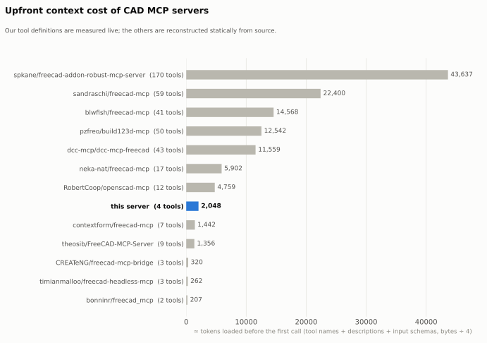
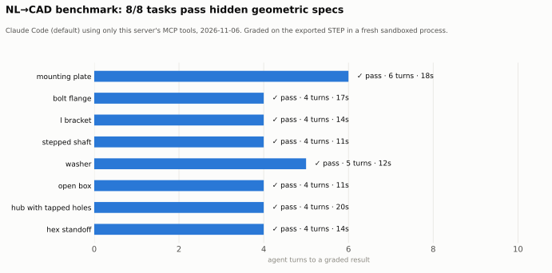

# Why this server

**This server is a Code Mode FreeCAD server.** The agent writes a short JavaScript program. That program runs in a QuickJS sandbox whose only way out is a small, typed `cad` API. Every CAD job then runs headless in a FreeCAD worker that is sandboxed by the kernel. The result is graded by a separate process that never runs the agent's code. It comes back as a structured verdict: what was expected, what was measured, and an image of the part.

We compared this server with **20+ CAD MCP servers** on 2026-11-06, 12 of them in detail. Sources: GitHub, PyPI, npm, the official MCP registry, and the project sources. See [landscape-and-tool-design.md](landscape-and-tool-design.md).

<picture><source media="(prefers-color-scheme: dark)" srcset="images/feature-matrix-dark.svg"></picture>

## 1. Code Mode: one program instead of many tool calls

Most CAD MCP servers expose one tool per operation. spkane has 170 tools, sandraschi 59, blwfish 41, build123d-mcp 50. That makes the agent:
- pay for every schema up front;
- spend a model round trip on every step;
- copy intermediate results through its own context.

This server exposes **four tools**: `search`, `execute`, `job_status`, `artifacts`. Everything else is a method on the `cad` object inside `execute`:

```js
// One execute call: build from a tested example with new parameters, validate, look at it, compare.
const a = await cad.run({ exampleId: "example.cadkit.mounting_plate", parameters: { length: 150 } });
const b = await cad.run({ fromJob: a.id, patch: [{ find: "corner=3", replace: "corner=6" }] });
return { a: a.ok, b: b.ok, diff: await cad.compare(a.id, b.id), preview: cad.preview(b.id) };
```

What this saves:

| | upfront tool definitions | per design iteration |
|---|---|---|
| this server | **≈2.0k tokens** (4 tools, measured live) | **≈116–132 tokens**: `exampleId` + compact result, or a `fromJob` patch for a repair |
| many tools (median of the 6 FreeCAD servers with 9+ tools) | ≈13k tokens (range 1.4k–43.6k) | several calls, each echoing state |
| same plate, full script + full result | — | ≈1,975 tokens |

<picture><source media="(prefers-color-scheme: dark)" srcset="images/tool-tokens-dark.svg"></picture>

**How the numbers were measured:**
- Our tool definitions come from a live `tools/list` (`scripts/list-tools.mjs`).
- Competitors' definitions were reconstructed **statically** from their source with `scripts/static_tool_extract.py`, which parses the source and never imports or runs it. Their runtime payloads may differ somewhat.
- Tokens are bytes ÷ 4.
- The per-iteration figures come from the bridge's own `stats.approxTokens`.

**Ideas taken from Cloudflare's Code Mode:**
- **A tiny tool surface.** `search` and `execute` are the core, and the typed `cad` declaration sits right in the `execute` description.
- **`search` can be code** run against a frozen, typed `catalog`, read-only, with no way to start jobs.
- **Credentials and file paths never enter the sandbox.** Artifacts are addressed by ID.
- **Budgets on every `execute` call:** wall time, memory, number of `cad` calls, concurrency, and output size. Results are truncated structurally rather than mid-JSON.

**Ideas specific to CAD:**
- **Scripts don't round-trip through the model.** `exampleId` builds from a tested catalog script. `fromJob` + `patch` repairs a previous job with a few `find`/`replace` edits instead of resending the whole script.
- **Design sweeps in a single call.** `Promise.all` over sizes or materials returns a ranked table instead of N conversations.
- **Compact results by default.** `cad.run` returns only failed checks, key geometry and artifact IDs; `cad.result(id, {full:true})` returns everything.

## 2. Accuracy: verified, not self-reported

Every job goes through two sandboxed processes:
1. **build:** runs the agent's FreeCAD Python and exports FCStd/STEP/STL.
2. **verify:** never runs agent code. It re-imports the exported files and measures them.

Because the agent's code can't touch the verify process, it can't fake its own result.

| check family | what it proves |
|---|---|
| shape | valid, non-null, solid count |
| design intent | bounding box, volume, holes by diameter / position / through-ness (full 360° concave cylinders only, so slot ends and fillets aren't counted), hole count |
| editability | `requireParametric` (constrained sketches and expressions), `requireFullyConstrained` (every sketch has 0 DoF, no conflicts) |
| robustness | `flexTests`: re-open the **saved FCStd**, change spreadsheet parameters, recompute, re-check. This catches the classic fillet-on-`Edge7` breakage (topological naming), which a one-shot build never shows. |
| engineering | mass for 12 materials, centre of mass, mass budget (`maxMassG`) |
| interoperability | STEP re-imported by a second importer, STL watertight, FCStd re-opened and compared with the STEP |

Each check reports `{name, passed, expected, actual, message}`. The message says how to fix the problem; one example is *"Dimensions match but on different axes — check sketch plane / extrusion direction."*

**NL→CAD benchmark** (`tests/eval/`):
- Claude Code, with only this server's tools, gets a plain-English task.
- A **hidden** spec the agent never sees grades the exported STEP: orientation-free bounding box, volume within 0.5%, and hole diameters and counts.
- The grader itself is validated against reference solutions for all 8 tasks.

**Result (2026-11-06, Claude Code default model, one run per task): 8/8 tasks pass, median 4 turns, 11–20 s wall time each, $1.26 for the whole suite.** On average a task used 1414 output tokens and 101k input tokens, almost all served from the prompt cache.

<picture><source media="(prefers-color-scheme: dark)" srcset="images/eval-dark.svg"></picture>

| task | hidden-spec pass | turns | wall | cost |
|---|---|---|---|---|
| mounting plate | ✅ | 6 | 18 s | $0.19 |
| bolt flange | ✅ | 4 | 17 s | $0.17 |
| l bracket | ✅ | 4 | 14 s | $0.14 |
| stepped shaft | ✅ | 4 | 11 s | $0.14 |
| washer | ✅ | 5 | 12 s | $0.15 |
| open box | ✅ | 4 | 11 s | $0.14 |
| hub with tapped holes | ✅ | 4 | 20 s | $0.17 |
| hex standoff | ✅ | 4 | 14 s | $0.15 |

Caveats: there are only 8 single-part tasks, each run once with one model. A clean sweep says the pipeline is dependable for prismatic and turned parts; it doesn't measure how harder parts would go. The plan is to add assemblies, freeform shapes and multi-step edits. To reproduce: `python3 tests/eval/run_eval.py` (≈$1.3).

## 3. Safety no other CAD MCP server offers

All the FreeCAD MCP servers we checked run AI-generated Python with the user's full privileges. Some state it outright: "full access by design", "not a sandbox". This server enforces isolation in the kernel, with no root and no containers required:
- **Landlock:** files are readable only from an allowlist and writable only in the job directory; TCP is denied; signals and abstract sockets are scoped to the sandbox.
- **seccomp:** no sockets, exec, fork, ptrace, mount or bpf.
- **rlimits** cap CPU, memory and file size.
- **A fresh process for every job, with a scrubbed environment.**

`tests/cad` checks all of this. The tests try reading `~`, `/etc/passwd` and `/proc/*/environ`, opening network sockets, running subprocesses, forking, signalling other processes, symlinking or hardlinking out of the job directory, and allocating 6 GB. Every attempt is blocked or contained.

## 4. Friendly for agents (and the people reading their work)

- **`cadkit`:** a tested helper layer. A fully constrained, spreadsheet-driven plate takes 10 lines instead of 80. Expressions such as `"length - edge"` work, and bare numbers get units automatically. Includes ISO 273 clearance, tap-drill and counterbore tables, and edge/face selectors that pick by geometry.
- **Curated catalog:** 33 entries covering the contract, tested examples, API reference and pitfalls, all tagged by module and FreeCAD version. `search` returns ranked, compact hits and puts cadkit examples first.
- **The model sees the part.** A headless 4-view preview comes back as MCP image content. It uses hidden-line removal, labels exact B-rep dimensions, and renders in about 0.5 s with no GUI.
- **Actionable errors.** Tracebacks show only the job script's own frames. `featureErrors` names the failing feature and FreeCAD's reason (for example, which sketch constraints conflict). Error codes are stable and come with repair hints.

## 5. Where others are stronger

These are honest gaps, and our roadmap:

| other server | strength we don't have yet |
|---|---|
| neka-nat/freecad-mcp | drives the user's **open FreeCAD GUI** live; parts library; FEM |
| spkane / blwfish | breadth: CAM, Draft, Assembly, TechDraw-level operations |
| build123d-mcp, openscad-mcp | printability and DFM analysis, interference checks, a published CADGenBench pipeline (build123d) |
| Onshape servers | cloud CAD with real assemblies and Variable Studios |

## 6. Brainstorm: next ways to stand out

- **Spec-first design.** `cad.spec("plate 120x80x10, 4×M6 12 mm from edges")` → a structured validation spec the agent confirms before modelling.
- **Assemblies with interference checks**, using the same verify-in-isolation model across multiple bodies.
- **DFM profiles**: `validation.dfm: "cnc_3axis" | "fdm" | "sheet_metal"`, covering minimum wall, minimum hole size, draft and undercuts.
- **Visual diff:** `cad.compare` renders before/after overlays as a single image.
- **TechDraw drawings** exported as a PDF/SVG artifact with dimensions.
- **Benchmark leaderboard in CI:** run `tests/eval` per release and track pass rate, turns, tokens and cost over time.
- **Remote HTTP transport** with per-user auth and microVM workers for multi-tenant hosting.
